<div align="center">

# Media Data Pipeline

**Hourly ELT from PostgreSQL to BigQuery, orchestrated by Airflow and modeled with dbt**


[Architecture](#architecture) · [Data model](#data-model) · [Walkthrough](#walkthrough) · [Setup](#setup) · [DAG flow](#dag-flow) · [Design decisions](#design-decisions)

</div>

## Highlights

- **Medallion layers:** raw bronze, cleaned silver, and a gold star schema, all in BigQuery.
- **Event-driven dbt:** `media_dbt` starts from an Airflow Asset, so it only runs after ingestion succeeds.
- **Resumable backfill:** the first run loads history since 2016 in 30-day chunks and continues from the last chunk that succeeded.
- **Soft and hard deletes handled:** soft deletes come through the change timestamp, and hard deletes are found by comparing against the source id list.
- **Author history kept:** an SCD Type 2 snapshot records how each author changes over time.

## Architecture

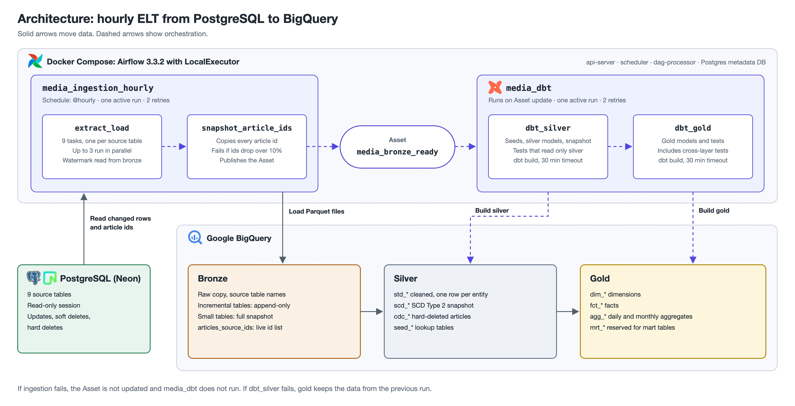

| Layer | Contents | Built by |
|---|---|---|
| **Bronze** | Raw copy of the source, with the same table names as the source. Incremental tables are append-only, and small tables are snapshotted | `pipeline/extract_load.py` |
| **Silver** | Cleaned data, grouped by prefix (see below) | `dbt/models/silver`, `dbt/snapshots` |
| **Gold** | Star schema and aggregates for analysis | `dbt/models/gold` |

### Naming conventions

| Prefix | Layer | Meaning |
|---|---|---|
| None | Bronze | Same name as the source table |
| `std_` | Silver | Per-entity standardization |
| `scd_` | Silver | Slowly changing dimension |
| `cdc_` | Silver | Change data capture |
| `seed_` | Silver | Lookup table loaded from a dbt seed |
| `dim_` | Gold | Dimension |
| `fct_` | Gold | Fact |
| `agg_` | Gold | Aggregate |
| `mrt_` | Gold | Mart table |

## Data model

The gold layer is a star schema. Keys are logical, because BigQuery does not enforce them.

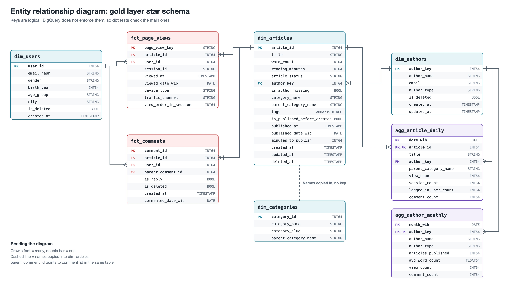

## Walkthrough

This section follows the data from start to finish, using the run from October 31, 2026.

### 1. Source data in Neon

The pipeline starts from 9 tables in a PostgreSQL database hosted on Neon. They hold the articles, authors, users, comments, page views, categories, tags, and the tables that link articles to categories and tags. `articles.content` stores raw HTML, which silver later cleans into plain text.

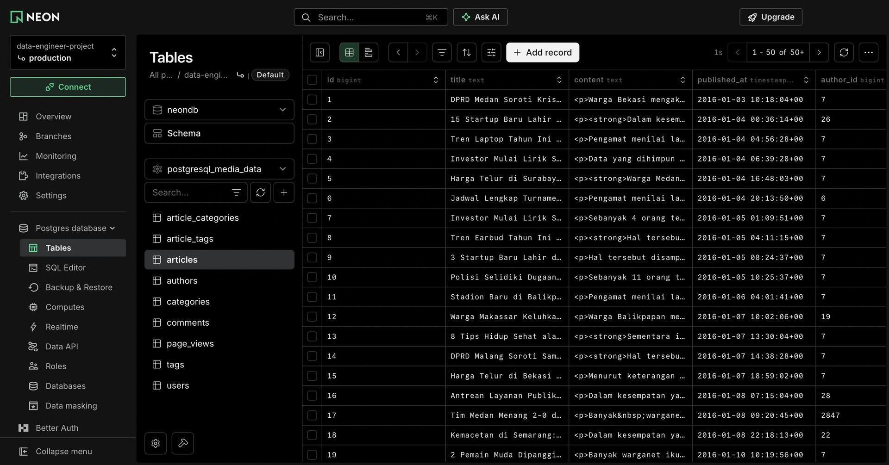

### 2. Pipeline in Airflow and dbt

`media_ingestion_hourly` loads the source tables into bronze every hour. When it succeeds, it updates the `media_bronze_ready` Asset, which starts `media_dbt`. dbt then builds and tests silver, followed by gold.

<table>
  <tr>
    <td width="50%">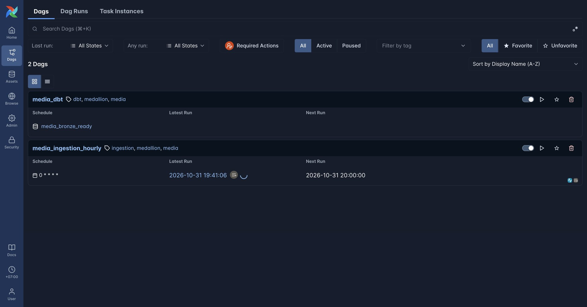</td>
    <td width="50%">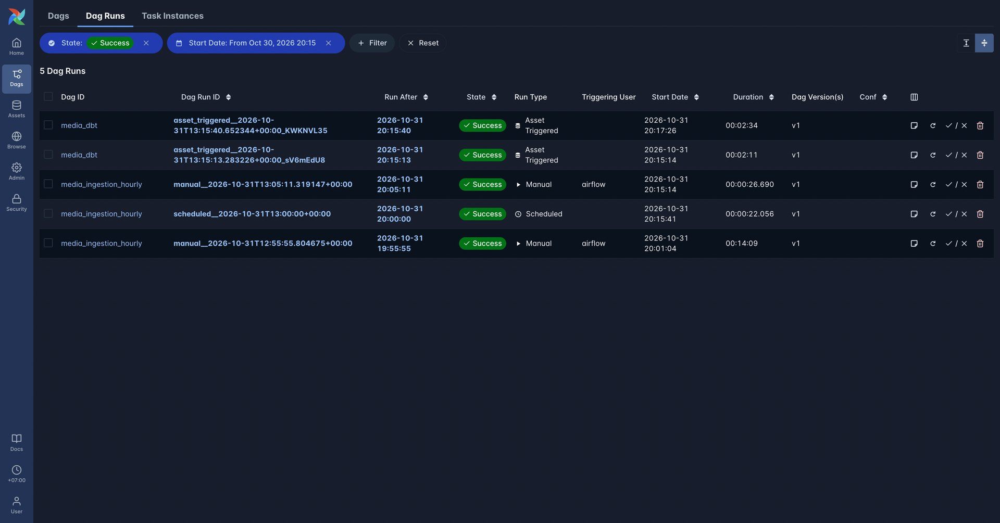</td>
  </tr>
  <tr>
    <td align="center"><b>Both DAGs.</b> <code>media_dbt</code> is scheduled by the Asset.</td>
    <td align="center"><b>Successful runs.</b> Each <code>media_dbt</code> run was triggered by the Asset.</td>
  </tr>
  <tr>
    <td width="50%">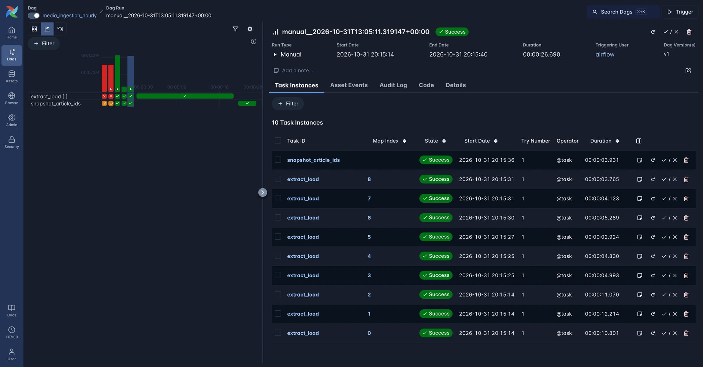</td>
    <td width="50%">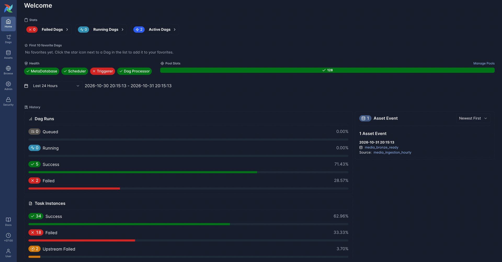</td>
  </tr>
  <tr>
    <td align="center"><b>Ingestion tasks.</b> One <code>extract_load</code> task per source table.</td>
    <td align="center"><b>Asset event.</b> The 2 failed runs were from setup, before the key and IAM roles were in place. Triggerer is red because this stack does not deploy one.</td>
  </tr>
</table>

Every step of the run passed:

| Check | Result |
|---|---|
| `media_ingestion_hourly` | 9 of 9 `extract_load` tasks and `snapshot_article_ids` succeeded |
| `dbt_silver` | 32 of 32 nodes passed, with no warnings |
| `dbt_gold` | 24 of 24 nodes passed, with no warnings |

### 3. Results in BigQuery

The run produced all three layers in BigQuery. Bronze keeps the source table names, while silver and gold follow the [naming conventions](#naming-conventions).

<table>
  <tr>
    <td width="50%">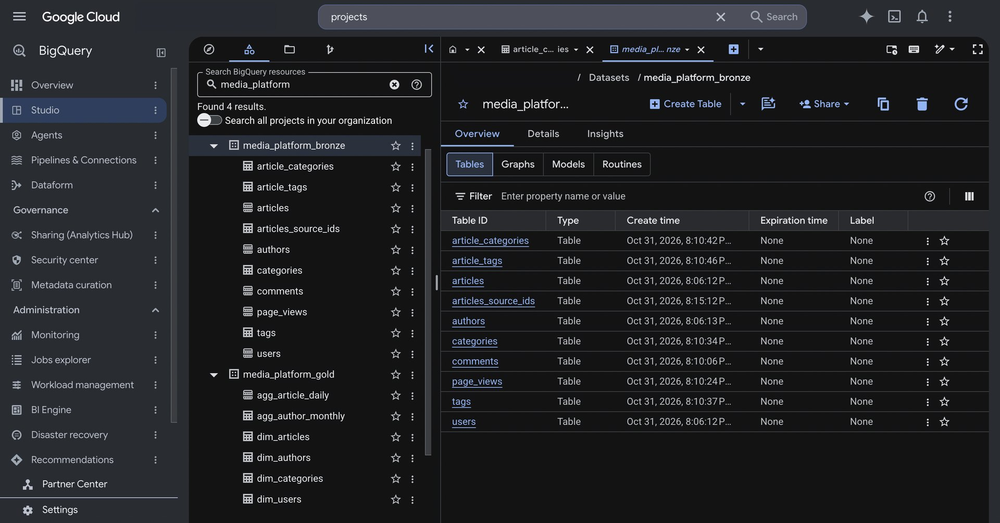</td>
    <td width="50%">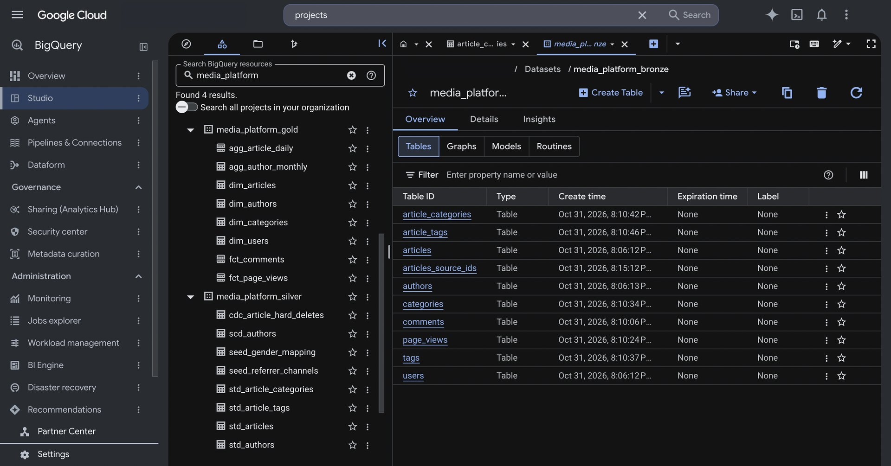</td>
  </tr>
  <tr>
    <td align="center"><b>Bronze.</b> Table names match the source.</td>
    <td align="center"><b>Silver and gold.</b> Tables follow the naming conventions.</td>
  </tr>
  <tr>
    <td width="50%">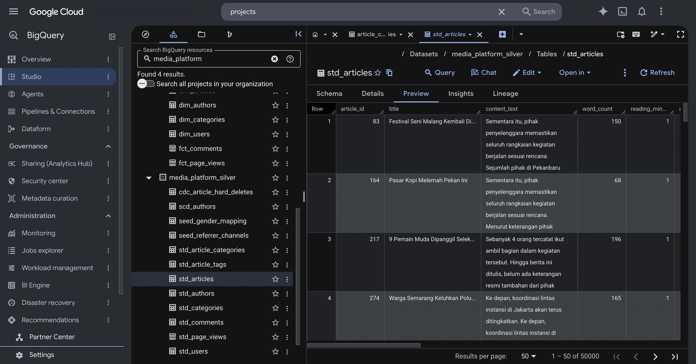</td>
    <td width="50%">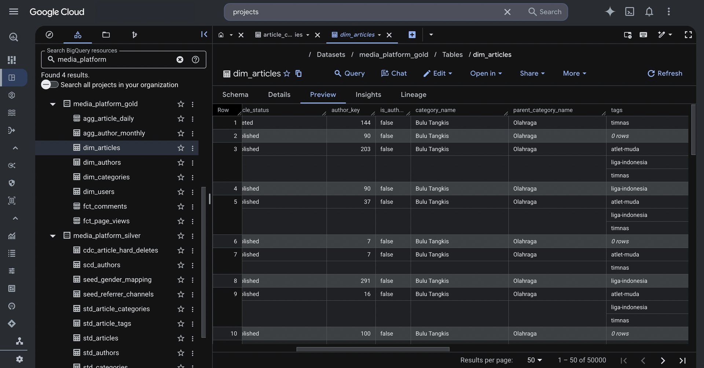</td>
  </tr>
  <tr>
    <td align="center"><b><code>std_articles</code>.</b> HTML is stripped into plain text.</td>
    <td align="center"><b><code>dim_articles</code>.</b> Articles with their author key, category, and tags.</td>
  </tr>
</table>

Row counts per layer show what each step did:

| Entity | Bronze | Silver | Gold |
|---|---:|---:|---:|
| Articles | 50,002 | 50,000 | 50,000 |
| Users | 30,002 | 30,000 | 30,000 |
| Comments | 120,002 | 120,000 | 120,000 |
| Page views | 505,006 | 500,000 | 488,770 |
| Authors | 408 | 406 | 401 |

Silver removes the duplicates found in bronze. Gold drops bot traffic from page views and merges authors who share an email, then adds one `Unknown` author row.

`cdc_article_hard_deletes` has 0 rows, so every article in silver still exists in the source.

### 4. Dashboard in Metabase

Metabase reads the gold tables in BigQuery. The Media Platform Dashboard has date and category filters, and three sections: traffic trends, content, and logged-in audience. The screenshots below are filtered to 2025.

<table>
  <tr>
    <td width="50%">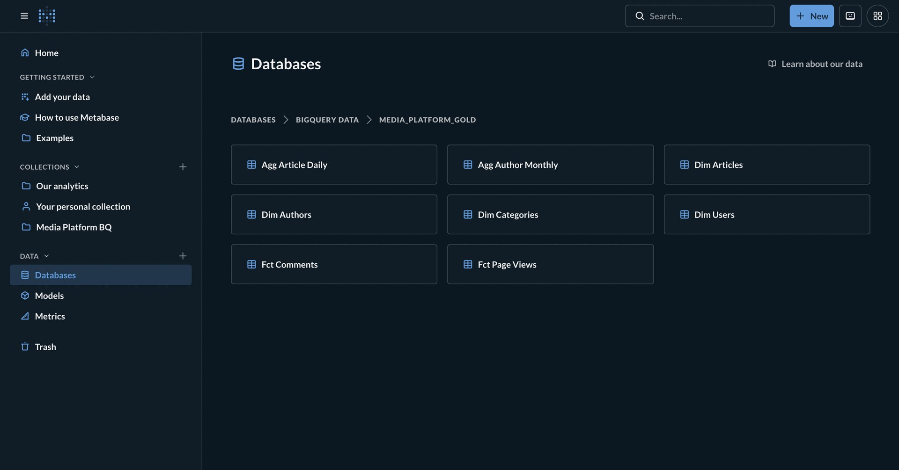</td>
    <td width="50%">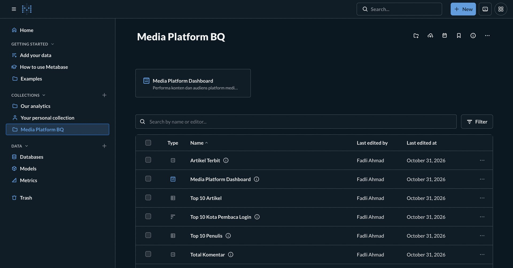</td>
  </tr>
  <tr>
    <td align="center"><b>Gold tables.</b> Metabase connects to the gold dataset.</td>
    <td align="center"><b>Collection.</b> The dashboard and its questions.</td>
  </tr>
  <tr>
    <td width="50%">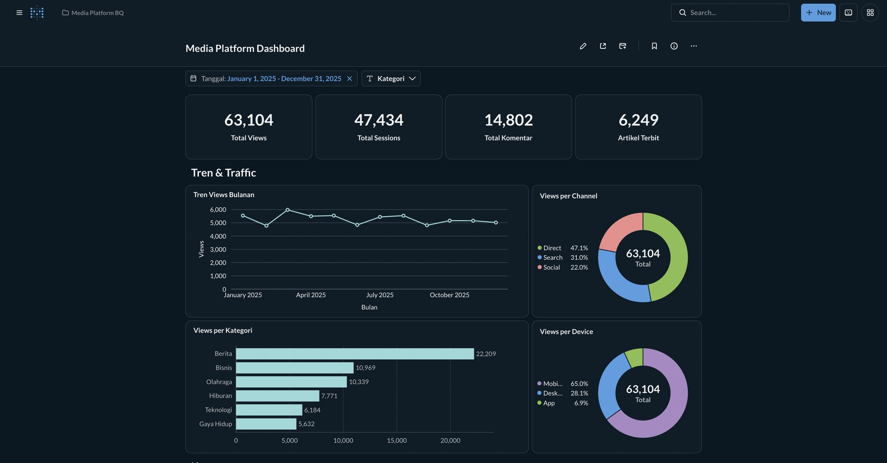</td>
    <td width="50%">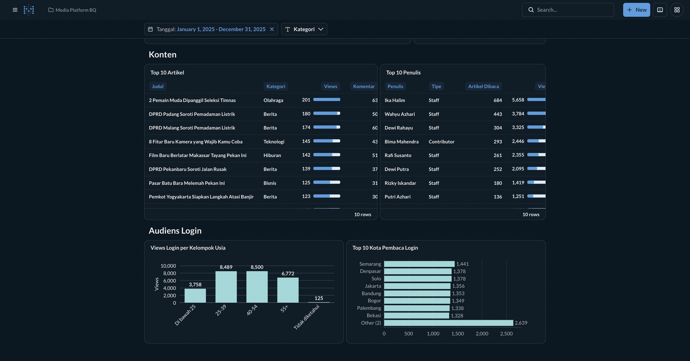</td>
  </tr>
  <tr>
    <td align="center"><b>Overview and traffic.</b> Views, sessions, comments, and published articles.</td>
    <td align="center"><b>Content and audience.</b> Top articles, top authors, and logged-in readers.</td>
  </tr>
</table>

The full dashboard is also available as a [PDF](docs/images/metabase/media_platform_dashboard.pdf).

## Setup

You need the following from BigQuery:

1. A GCP project with billing enabled. Sandbox mode will not work because it blocks DML, and dbt uses `MERGE`.
2. A service account with two roles: **BigQuery Data Editor** and **BigQuery Job User**.
3. The service account's JSON key, saved as `secrets/gcp-service-account.json`.

Then copy `.env.example` to `.env` and fill it in. The main BigQuery settings are:

| Variable | Value |
|---|---|
| `BQ_PROJECT_ID` | GCP project ID |
| `BQ_LOCATION` | Dataset location, which must match the datasets exactly, for example `asia-southeast2` |
| `BQ_DATASET_BRONZE`, `BQ_DATASET_SILVER`, `BQ_DATASET_GOLD` | Dataset name for each layer. If you only have one dataset, use the same name for all three |

Start the stack:

```bash
docker compose up -d --build
```

Open http://localhost:8080. The username and password are `AIRFLOW_ADMIN_USERNAME` and `AIRFLOW_ADMIN_PASSWORD` in `.env`.

> [!IMPORTANT]
> The `media_ingestion_hourly` and `media_dbt` DAGs start paused. Unpause both once `.env` and the key are in place.

### Metabase

Metabase stores its own data in the Compose Postgres, in a separate `metabase` database. On a new setup, set `MB_DB_PASS` and `MB_ENCRYPTION_SECRET_KEY` in `.env`, then create the role and database with the same password:

```bash
docker compose exec postgres psql -U airflow -d airflow \
  -c "CREATE ROLE metabase LOGIN PASSWORD 'your-mb-db-pass';" \
  -c "CREATE DATABASE metabase OWNER metabase;"
docker compose restart metabase
```

Open http://localhost:3000, finish the setup screen, and add BigQuery as a database with the gold dataset.

## DAG flow

`media_ingestion_hourly` runs every hour, with one active run at a time:

1. `extract_load`: one task per source table, with up to three running in parallel.
2. `snapshot_article_ids`: copies all article ids from the source, then updates the `media_bronze_ready` Asset.

`media_dbt` has no schedule of its own. It runs each time the `media_bronze_ready` Asset is updated:

1. `dbt_silver`: loads seeds, builds the silver models and snapshot, then runs the tests that read only this layer.
2. `dbt_gold`: builds the gold models, then runs the gold tests, including tests that also read silver.

If ingestion fails, the Asset is not updated and `media_dbt` does not run. If `dbt_silver` fails, `dbt_gold` does not run, so gold keeps the data from the previous run. To rerun a single layer, clear its task in Airflow.

## Design decisions

### Watermark

The watermark comes from `MAX(_source_change_ts)` in the bronze table, so it only advances once a BigQuery load job has committed. Each run rereads the last 15 minutes to catch transactions that committed late, and silver removes the duplicates.

### Soft delete

`updated_at` does not change when an article is deleted, so the change timestamp is `GREATEST(updated_at, deleted_at)`.

### Bonus 1: data since 2016

The first run detects an empty bronze table, then loads the data in 30-day chunks starting from the oldest row. If it fails partway, the next run resumes from the last chunk that succeeded. No separate backfill DAG is needed, and `catchup=False` because a single run catches up on everything it missed. In production, read from a read replica and run outside peak hours.

### Bonus 2: hard delete

Deleted rows leave no trace for the watermark, so all article ids are copied to `articles_source_ids` every hour. `dim_articles` inner joins on that list, and missing ids are recorded in `cdc_article_hard_deletes`.

- The id snapshot runs after extract, so new articles do not look deleted.
- If the id count drops by more than 10%, the snapshot is rejected and the task fails, so a faulty source cannot empty gold.
- `fct_page_views` keeps the view history of deleted articles. `agg_article_daily` follows `dim_articles`.
- Copying all ids does not suit millions of rows per hour. At that scale, CDC from the WAL is a better fit, for example with Debezium.

### Scale

The `GREATEST(updated_at, deleted_at)` expression has no index yet. This is fine at 50,000 rows, but production needs an expression index on the source.

## Project structure

```text
.
├── dags/
│   ├── bigquery_ingestion_dags/   # media_ingestion_hourly
│   └── dbt_dags/                  # media_dbt
├── pipeline/                      # Extract from Postgres, load to bronze, shared Assets
├── dbt/
│   ├── models/
│   │   ├── bronze/                # Source definitions for the raw tables
│   │   ├── silver/                # std_* and cdc_* models
│   │   └── gold/                  # dim_*, fct_*, and agg_* models
│   ├── snapshots/                 # scd_authors
│   ├── seeds/                     # Lookup tables
│   ├── macros/                    # Shared SQL macros
│   ├── tests/                     # Custom data tests
│   └── analyses/                  # Ad hoc SQL
├── docs/images/                   # Diagrams, screenshots, and the Metabase dashboard
├── secrets/                       # Service account key (not committed)
├── docker-compose.yaml
└── Dockerfile
```
